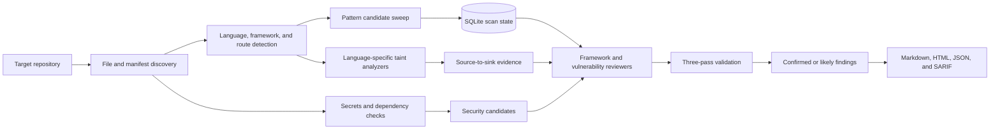

# Code-VulnScan Architecture

Code-VulnScan combines deterministic candidate discovery with an evidence-driven review workflow. The scripts make scans reproducible; the reviewer playbooks supply framework semantics, exploitability checks, and false-positive controls that simple pattern matching cannot provide.

## Scan flow

The initial pattern sweep is deliberately a discovery step. A matching API name is not itself a vulnerability. Findings become reportable only after the review establishes attacker-controlled input, a complete path to impact, ineffective or absent mitigation, and realistic reachability.

## Runtime components

| Component | Responsibility |
|---|---|
| `SKILL.md` | Main workflow, routing rules, required phases, and reporting contract |
| `scripts/scan.py` | Repository enumeration, polyglot framework detection, route discovery, candidate persistence, and resume support |
| `scripts/taint.py` | Taint dispatcher and shared Python/JavaScript/PHP/Ruby analysis |
| `scripts/taint_go.py` | Go request-to-sink tracking |
| `scripts/taint_java.py` | Java web/JVM tracking |
| `scripts/taint_kotlin.py` | Kotlin Spring and Ktor tracking |
| `scripts/taint_csharp.py` | ASP.NET/.NET tracking |
| `scripts/taint_rust.py` | Actix-web, Axum, Warp, and Rocket tracking |
| `scripts/dependency.py` | Manifest and lockfile parsing, local CVE matching, and optional OSV lookup |
| `scripts/secrets.py` | Pattern and entropy-based secret discovery, including optional Git history |
| `scripts/orchestrate.py` | Groups candidates into reviewer-specific, self-contained phase payloads |
| `sub-skills/*.md` | Manual data-flow, framework, architecture, infrastructure, and exploitability review guidance |
| `scripts/report.py` | Markdown, HTML, JSON, and SARIF generation from reviewed findings |

## Language and framework routing

Language detection is extension-based, with special handling for templates and manifests. Framework signals are collected across the full enumerated source set so a large polyglot repository is not classified from only its first files. Route extraction is then selected per source language rather than applying one repository-wide framework to every file.

Dedicated taint analyzers currently exist for Python, Go, Java, Kotlin, C#, and Rust. JavaScript/TypeScript, PHP, and Ruby use variable-aware tracking in the shared analyzer. Pattern files cover these languages plus C/C++, Swift, Bash, YAML, and infrastructure formats. Framework reviewers add semantics for the major server stacks listed in `SKILL.md`.

## State and phase orchestration

`scripts/scan.py` stores scan runs and candidates in `workspace/scan_state.db`. `--resume` reuses an unfinished run and skips files represented by existing candidates. After deterministic discovery, `scripts/orchestrate.py --phase <name>` selects relevant candidates and embeds the corresponding reviewer guidance and nearby code in a JSON payload.

Reviewed results are returned through `scripts/scan.py --update-findings <json>`. The reporting layer includes only findings whose status and evidence meet the workflow's confirmation threshold. That completion command writes Markdown, HTML, JSON, SARIF, canonical confirmed-findings JSON, and the target repository's `Vulnscan_results.md`; a validated empty result set produces the same complete artifact set.

## Dependency model

Dependency discovery includes direct manifests and resolved lock state. The parser supports Python/Pipenv/Poetry, npm/Yarn/pnpm, Maven, Gradle properties/catalogs/locks, Go modules, Bundler, Composer, Cargo, and NuGet project/central-package/lock/Paket formats. Maven coordinates retain group and artifact identity for OSV queries; unresolved ranges and inherited versions are not silently treated as concrete installed versions.

Local CVE matches are a fast baseline, not an exploitability conclusion. The dependency reviewer must confirm the resolved version, affected feature or code path, deployment exposure, and compensating controls.

## Correctness boundaries

- Pattern findings are candidates and require source, path, and context verification.
- The taint analyzers are lightweight and mostly intra-file; they do not replace a compiler-grade whole-program data-flow engine.
- Route and framework discovery favors useful coverage but cannot fully resolve metaprogramming, generated registration, reflection, or runtime plug-ins.
- Safe test fixtures are regression controls, not proof that every equivalent mitigation is recognized.
- Dependency parsers prefer concrete resolved versions; build-tool evaluation may still be required for custom functions, remote parent metadata, or dynamic constraints.

These boundaries are why the workflow always combines deterministic evidence with the framework reviewers and `sub-skills/false-positive-filter.md`.

## Extension points

1. Add or refine discovery rules in `resources/patterns/<language>_patterns.json`.
2. Add language detection and manifest discovery in `scripts/utils/languages.py`.
3. Add a dedicated taint analyzer and dispatch it from `scripts/taint.py` when source/sink semantics justify one.
4. Add framework route patterns in `scripts/routes.py` and reviewer guidance under `sub-skills/`.
5. Add vulnerable and safe benchmark fixtures, labels, and focused regression tests together.
6. Run the complete test suite, benchmark, skill validator, JSON validation, Python compilation, and package smoke tests before release.
